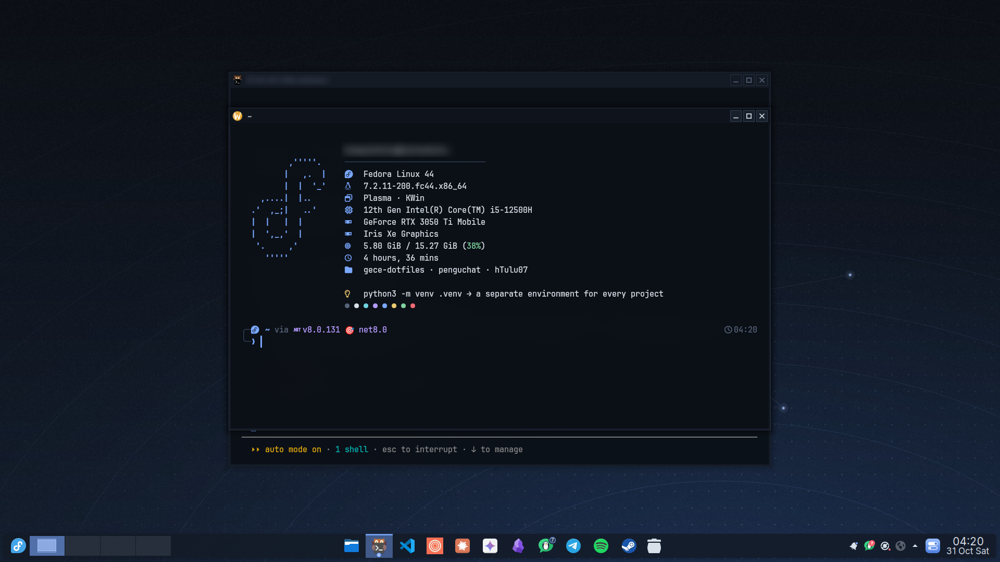

# Gece

My KDE Plasma 6 setup on Fedora: a quiet night-blue desktop. *Gece* means "night" in Turkish.



## What's inside

| Part | Files |
| --- | --- |
| Colors | `share/color-schemes/Gece.colors` (navy `#0f141c`, ice blue `#7aa8ff`) |
| Window frames | `share/aurorae/themes/Gece-Classic` |
| Bottom bar | `plasma/layout.js` (one floating bar: menu, desktops, apps, media, tray, clock) |
| Control center | [Gece Control](https://github.com/hTulu07/gece-control) widget (installed by `plasma/apply.sh`) |
| Terminal | `config/kitty/` (kitty + Gece palette), `share/konsole/` (Konsole profile) |
| Shell | `home/.zshrc`, `config/zsh/gece.zsh` (aliases, `proj`, `newc`/`newpy`/`newcs`), `config/starship.toml`, `config/fastfetch/` with a random tip from `config/zsh/tips.txt` |
| System monitor | `config/btop/themes/gece.theme` |
| Browser | `zen/` (Zen Browser: native title bar, Gece colors) |
| Notes | `obsidian/gece.css` (Obsidian CSS snippet) |
| Boot splash | `system/plymouth/gece/` |
| Login screen | `system/plasmalogin/` (Plasma Login Manager colors + wallpaper) |
| Wallpaper | `wallpapers/gece.png` (4K) |


## Install

```sh
git clone https://github.com/hTulu07/gece-dotfiles ~/Projects/gece-dotfiles
cd ~/Projects/gece-dotfiles
sudo dnf install $(grep -v '^#' packages.txt)   # tools used by the shell setup
./install.sh                                     # configs + Plasma look
sudo ./system/install.sh                         # optional: boot splash + login screen
```

- `install.sh` links the configs into place, so editing a file here changes your setup.
  Anything it replaces is moved to `~/.dotfiles-backup-<date>`.
- `./install.sh --no-plasma` skips the desktop part (useful on another desktop).
- `GECE_KEEP_PANELS=1 ./install.sh` keeps your current panels instead of the Gece bar.
- Put API keys and other private exports in `~/.config/zsh/secrets.zsh`; `.zshrc` loads it and git ignores it.

Also used: [starship](https://starship.rs) prompt, [Inter](https://rsms.me/inter/) and
[JetBrainsMono Nerd Font](https://www.nerdfonts.com/) fonts, [Papirus](https://github.com/PapirusDevelopmentTeam/papirus-icon-theme) icons.

## License

MIT

The spinner images in `system/plymouth/gece/` are recolored from Plymouth's *spinner* theme (GPL-2.0-or-later).
